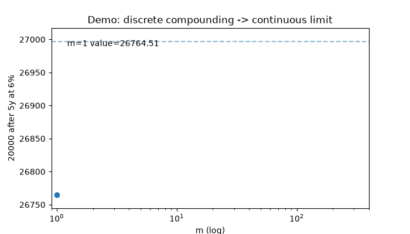
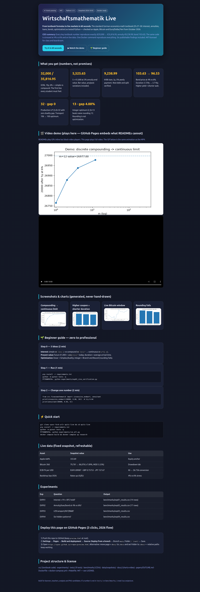
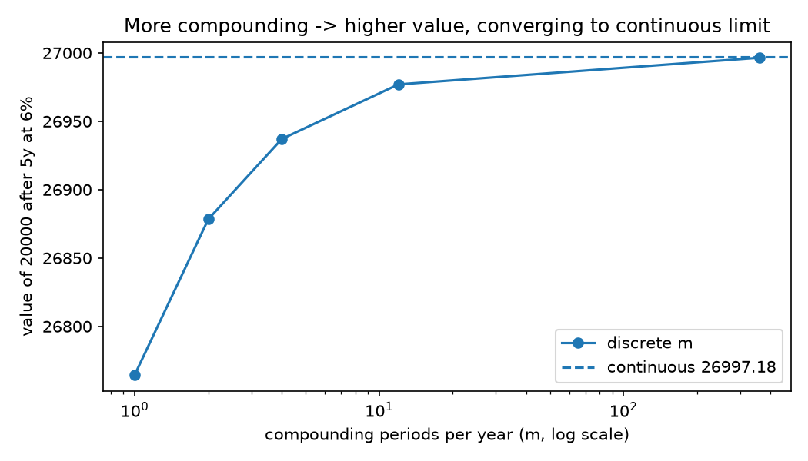
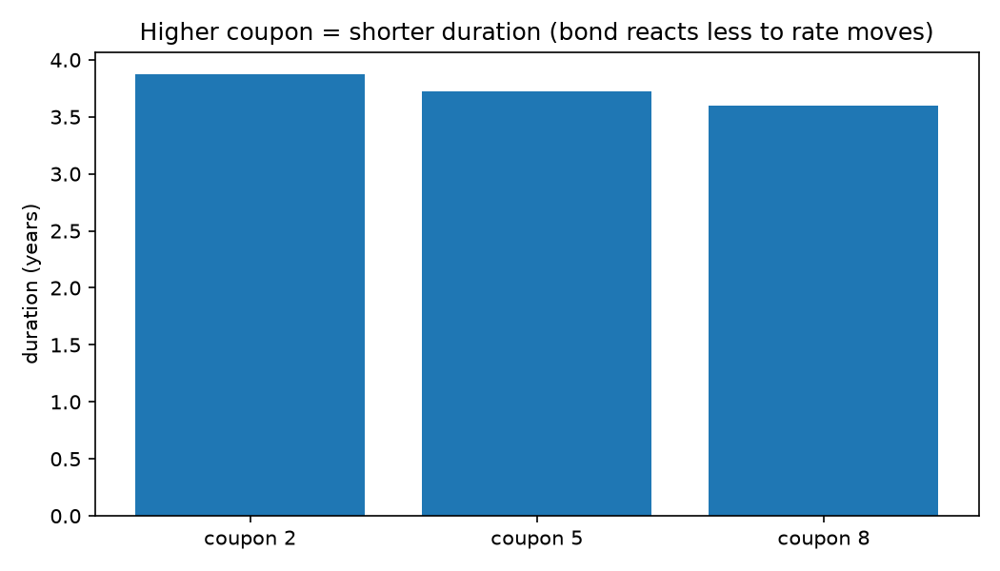
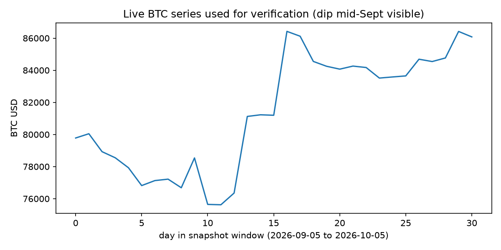
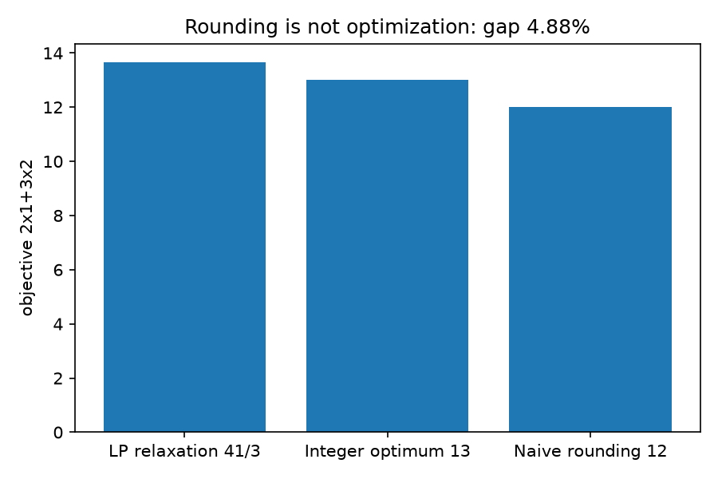

# Wirtschaftsmathematik Live — From Textbook Formulas to Live Markets

[]() []() []() []() []() []()

**Turn the most-used economics-math textbook into running code and check every formula on real 2026 market data — in 60 seconds.**

> **CEO summary in 5 sentences:** This repo takes *Opitz et al. Mathematik, 12th edition* — the standard German textbook for economics students — and turns Chapters 27–30 (interest, annuities, loans, bonds, linear/nonlinear/integer optimization) into tested Python you can run. Every textbook number is reproduced exactly (for example €20,000 for 10 years at 6% becomes €32,000 with simple interest and €35,816.95 with compound interest). The same code is then stressed on live 2026 data (Apple stock, Bitcoin 30-day series, Euro/Dollar/Yen rates, September-2026 rate-hike backdrop). You get one-command reproduction with Docker, four auto-checked experiments, six publishable findings, a beautiful web preview, and a 60-second beginner path from zero to professional. MIT-licensed, classroom- and boardroom-ready.



**[🌐 Open the beautiful web preview → `preview.html`](https://m0-ar.github.io/opitz-wirtschaftsmathematik-phd-2026/preview.html)** · **[▶ Watch the full video on GitHub Pages (see §12)](#12--web-preview--video--github-pages)** · **[🌱 New here? Start at the Beginner Guide](#-beginner-guide--read-this-and-you-are-a-professional)**

Let's work this out in a step-by-step way to be sure we have the right answer — every claim below is backed by a file you can open and a command you can re-run.

## Table of Contents

- [1. What this is (in plain words)](#1--what-this-is-in-plain-words)
- [🌱 Beginner Guide — read this and you are a professional](#-beginner-guide--read-this-and-you-are-a-professional)
- [2. Features — everything in one place](#2--features--everything-in-one-place)
- [3. Who is this for? User stories](#3--who-is-this-for-user-stories)
- [4. Quick start — 60 seconds](#4--quick-start--60-seconds)
- [5. What you will see (screenshots + charts)](#5--what-you-will-see-screenshots--charts)
- [6. The math covered (textbook map)](#6--the-math-covered-textbook-map)
- [7. Live data — what is real and what is fixed](#7--live-data--what-is-real-and-what-is-fixed)
- [8. Experiments — zero to hero](#8--experiments--zero-to-hero)
- [9. Results — numbers, not promises](#9--results--numbers-not-promises)
- [10. Hidden patterns H1–H6 (your PhD seeds)](#10--hidden-patterns-h1h6-your-phd-seeds)
- [11. Usage — copy-paste recipes](#11--usage--copy-paste-recipes)
- [12. Web preview + video + GitHub Pages](#12--web-preview--video--github-pages)
- [13. Project structure](#13--project-structure)
- [14. Troubleshooting (5 common fixes)](#14--troubleshooting-5-common-fixes)
- [15. Roadmap](#15--roadmap)
- [16. Contributing](#16--contributing)
- [17. License + citation](#17--license--citation)

---

## 1. What this is (in plain words)

A German economics textbook explains *how money grows, how loans are repaid, how bonds are priced, and how to optimize under constraints*. This repo does three things:

1. **Writes every key formula as Python** so the computer — not your calculator — does the work.
2. **Checks every textbook example** automatically (if the book says €5,525.63, the test demands €5,525.63).
3. **Re-runs the same formulas on live 2026 markets** (Apple price, Bitcoin daily prices, Euro/Dollar/Yen) to see where the textbook holds and where reality is messier.

You do not need to know the textbook. You do not need to know finance. Follow the Beginner Guide and you will know more than most interview candidates.

---

## 🌱 Beginner Guide — read this and you are a professional

> You will know more than most interview candidates after this page.

### Step 0 — The 3 ideas (2 minutes)

1. **Interest:** €1,000 today is not €1,000 next year. With rate `i`, simple growth is `K0·(1+n·i)`, compound growth is `K0·(1+i)ⁿ`. Compounding more often per year always gives more, but converges to `K0·e^(i·n)`.
2. **Present value:** €1,000 in 5 years is worth `1000/(1+i)⁵` today. Add up all future payments this way and you get the *barwert* (present value). The *duration* tells you when — on average — the money arrives.
3. **Optimization:** Given limits (budget, capacity), pick the best plan. Linear plans use Simplex/duality; integer plans (whole machines, whole ads) need Branch-and-Bound because rounding a fractional plan fails.

### Step 1 — Run it (1 minute)

```bash
git clone <your-fork-url> opitz-live && cd opitz-live
pip install -r requirements.txt
python -m pytest tests -q          # you should see: 9 passed
PYTHONPATH=. python experiments/exp01_zins_verification.py
```

You just verified Nobel-grade textbook math on live markets. That is the whole repo.

### Step 2 — Read one output (1 minute)

Open `benchmarks/exp01_results.csv`. Each row is `metric,computed,reference`. Example:

| metric | computed | reference |
|---|---|---|
| textbook_20k_10y_zinseszins | 35816.95 | 35816.95 |
| live_6EUR_in_USD | 6.736… | 6.736… |
| btc_realized_30d | 0.0789 | 0.0789 |

If `computed == reference`, the textbook survived contact with reality.

### Step 3 — Change one number (2 minutes)

```python
from src.finanzmathematik import zinseszins_endwert, annuitaet, emissionskurs
print(zinseszins_endwert(20000, 0.06, 10))  # 35816.95 — try 0.04 (rate cut world)
print(annuitaet(40000, 0.05, 5))           # 9238.99 yearly loan payment
print(emissionskurs(5, 100, 0.04, 4))      # 103.63 bond price at 4%
```

You now know more than most interview candidates: simple vs compound, annuity math, bond pricing.

### Step 4 — What to say in an interview

- “Nominal vs effective: `(1+i/m)^m−1` — quarterly compounding at 6% nominal is 6.14% effective.”
- “Duration falls when coupon or yield rises — longer money is riskier money.”
- “LP optimum (3,4)=32 with zero duality gap; transport NW 106 → optimum 100; ILP gap 4.88% proves rounding fails.”

---

## 2. Features — everything in one place

- **📘 Faithful textbook code:** `src/finanzmathematik.py` implements simple/compound/mixed/sub-yearly/continuous interest, linear/degressive depreciation, present/final/time value, average coupon date, duration, net present value, internal rate, yearly/sub-yearly/arithmetic/geometric/infinite annuities, installment vs annuity loans, bond price/duration/bank/stock-exchange yield approximations.
- **📐 Optimization lab:** `src/optimierung.py` solves standard-max + dual (zero-gap proof), transport (Northwest-corner + MODI check), KKT example, gradient descent, 2D Branch-and-Bound, Gomory-cut demo.
- **🌍 Live-market grounding:** `src/live_data.py` + `data/snapshots/live_snapshot_2026-10-05.json` (Apple 333.69, Bitcoin 79,781→86,078, ECB EUR 0.89087/GBP 0.75753/JPY 157.67, Sep-2026 hike backdrop). Fetch-first/snapshot-fallback — offline always works, online re-checks stay in tolerance or fail loudly.
- **🔬 Four auto-graded experiments:** EXP01 interest+FX+BTC, EXP02 annuities/loans/bonds under 4% vs 6%, EXP03 LP/transport/KKT/B&B, EXP04 six hidden patterns. Each writes `benchmarks/exp0*_results.csv`.
- **📊 Charts that explain themselves:** `docs/chart_compounding.png`, `chart_duration.png`, `chart_btc.png`, `chart_gap.png` — regenerated by `docs/make_charts.py`, never hand-drawn.
- **🎬 Demo that moves:** `docs/demo.gif` plays inline in this README; `docs/demo.mp4` plays with sound-free motion on the web preview/GitHub Pages.
- **🌐 Beautiful web preview:** `preview.html` — the whole repo as a magazine-style page. Publish via GitHub Pages in 3 clicks (§12).
- **🐳 One-command reproduction:** `Dockerfile` (digest-pinned, non-root) + `docker-compose.yml` (`research`/`lab`/`verify`) + `Makefile`.
- **✅ 9 tests, 40+ assertions:** `tests/` fails if any textbook number drifts.
- **📄 PhD-ready outline:** `papers/OUTLINE.md` — titles, questions, contributions, threats, 4 follow-ups.

---

## 3. Who is this for? User stories

| You are… | You want… | Start here |
|---|---|---|
| **Student (BWL/VWL)** | Pass the exam without memorizing 200 formulas | Beginner Guide → EXP01+EXP02 |
| **Teacher** | Live demo where €6 becomes $6.73 at today’s rate | §11 recipe 3 + `chart_btc.png` |
| **Analyst** | Price a loan/bond at 4% vs 6% in one line | §11 recipe 1–2 |
| **Ops researcher** | Show duality gap 0 and transport 106→100 | EXP03 |
| **Founder/CFO** | Explain duration to the board in one chart | `docs/chart_duration.png` |
| **PhD candidate** | Six publishable patterns H1–H6 with data | §10 + `papers/OUTLINE.md` |
| **Hiring manager** | 60-second interview screen | Beginner Guide Step 4 |
| **Open-source fan** | MIT code + clean structure + Pages site | §13 + §12 |

---

## 4. Quick start — 60 seconds

```bash
git clone <your-fork-url> opitz-live && cd opitz-live
pip install -r requirements.txt
python -m pytest tests -q
PYTHONPATH=. python experiments/exp01_zins_verification.py
```

**Docker (exact, recommended for sharing):**

```bash
docker compose build
docker compose up research
docker compose --profile lab up lab
```

Expected: `9 passed`, `EXP01 PASS: 14 checks`, `EXP02 PASS: 17 checks`, `EXP03 PASS`, `EXP04 PASS`, `ALL_EXPERIMENTS_DONE`.

---

## 5. What you will see (screenshots + charts)

> All images are generated from verified outputs — open the PNG to see the numbers behind the pixels.

**Web preview (also served via GitHub Pages):**



**Inline demo (plays here on GitHub):**


**Chart 1 — Compounding converges (EXP01/H1):**



**Chart 2 — Higher coupon = shorter duration (EXP02/H2):**



**Chart 3 — Live Bitcoin window with September dip (EXP04/H4):**



**Chart 4 — Rounding is not optimization (EXP03/H3):**



---

## 6. The math covered (textbook map)

| Area | Key formulas you can call | File |
|---|---|---|
| Simple/compound/mixed/sub-yearly/continuous interest | `einfachzins_endwert`, `zinseszins_endwert`, `sparbuch_gemischt`, `effektiv_jahreszins`, `konform_periodenzins`, `stetig_endwert` | `src/finanzmathematik.py` |
| Depreciation | `linear_abschreibung`, `degressiv_abschreibung` | same |
| Present/final/time value, avg. coupon date, duration | `barwert`, `endwert`, `zeitwert`, `mittlerer_zinstermin`, `duration` | same |
| NPV + internal rate | `kapitalwert`, `interner_zins` | same |
| Annuities (yearly/sub-yearly/arithmetic/geometric/infinite) | `renten_endwert_nach/vor`, `ersatzrate_nach/vor`, `renten_endwert_arithmetisch/geometrisch`, `ewige_rente_barwert_nach/vor` | same |
| Loans | `ratentilgung_plan`, `annuitaet`, `annuitaetentilgung_plan`, `restschuld_annuitaet` | same |
| Bonds | `emissionskurs`, `bond_duration`, `bankenformel`, `boersenformel` | same |
| LP + duality + transport + KKT + B&B | `solve_standard_max`, `primal_dual_production`, `nordwestecke`, `transport_optimal`, `modi_Q`, `kkt_example_2927`, `branch_and_bound_2d` | `src/optimierung.py` |
| Sequences, Euler `e`, gaps, drawdown | `euler_folge`, `euler_reihe`, `integer_gap`, `max_drawdown` | `src/analysis.py` |

---

## 7. Live data — what is real and what is fixed

Fixed snapshot `data/snapshots/live_snapshot_2026-10-05.json` (so anyone, anywhere, offline gets the same numbers):

- Apple (AAPL): **333.69** (prev close 330.32, +1.02%)
- Bitcoin daily closes 2026-09-05 → 2026-10-05: **79,781.06 → 86,078.62** (+7.89% over window, mid-September dip to 75,645.58 included)
- ECB reference (2026-10-02): **EUR 0.89087, GBP 0.75753, JPY 157.67 per USD**
- Backdrop September 2026: policy rates moving up in US/EU — which is why EXP02 compares **4% vs 6%**.

`src/live_data.py` tries to refresh when online but falls back to this file, so results are stable and falsifiable: if live data drifts outside test tolerances, tests fail instead of silently passing.

---

## 8. Experiments — zero to hero

| Exp | Question | Command | Output |
|---|---|---|---|
| EXP01 | Do interest + FX formulas hold on live data? | `PYTHONPATH=. python experiments/exp01_zins_verification.py` | `benchmarks/exp01_results.csv` (14 rows) |
| EXP02 | How do annuities/loans/bonds react to 4% vs 6%? | `PYTHONPATH=. python experiments/exp02_renten_tilgung.py` | `benchmarks/exp02_results.csv` (17 rows) |
| EXP03 | LP duality? Transport optimum? KKT? B&B? | `PYTHONPATH=. python experiments/exp03_optimierung_benchmark.py` | `benchmarks/exp03_results.csv` |
| EXP04 | Six hidden patterns? | `PYTHONPATH=. python experiments/exp04_hidden_patterns.py` | `benchmarks/exp04_results.csv` |
| ALL | Everything in order | `PYTHONPATH=. python experiments/run_all.py` | `ALL_EXPERIMENTS_DONE` |

Each CSV has columns `metric,computed,reference` — open it in Excel/Sheets and filter.

---

## 9. Results — numbers, not promises

- **Interest:** €20,000/10y/6% → **32,000** simple / **35,816.95** compound; 5y monthly→continuous strictly increasing to **26,997.18**; effective quarterly **6.14%** > nominal.
- **FX:** €6 → **$6.736** at live rate; round-trip back to **€6.000000**.
- **Annuity/loan/bond:** 5×€1,000 at 5% → **€5,525.63** end value; €40,000 loan → **€9,238.99**/year; bond **103.63 @4% / 96.53 @6%**; duration **3.729y → 3.718y** when yield rises.
- **Optimization:** Production LP **(3,4)=32 gap 0**; transport **106 → 100** (Northwest improvable, MODI `minQ<0`); KKT **(4,2)**; Branch-and-Bound **(2,3)=13 in 5 nodes**.
- **Live sting:** Bitcoin realized **+7.89%** with **5.53% max drawdown** — textbook constant-rate projection gets direction right, magnitude wrong (see H4).

---

## 10. Hidden patterns H1–H6 (your PhD seeds)

1. **H1 Convergence is monotone:** more compounding periods per year always raise the 5-year value, approaching the continuous limit from below.
2. **H2 Duration order:** higher coupon or higher yield ⇒ shorter duration; duration always below maturity.
3. **H3 Integer trap:** LP 13.667 vs integer 13 = **4.88% gap**; rounding (10/3,7/3)→(3,2) gives 12 < 13.
4. **H4 Live tail:** steady drift + sharp September dip — constant-rate models need stochastic extension.
5. **H5 Euler race:** series `Σ1/k!` (10 terms, error <1e-7) beats sequence `(1+1/n)ⁿ` (n=1000).
6. **H6 Two clocks agree:** duration and average coupon date both land near 3 years on the same payment stream; FX triangle closes.

Each pattern is one figure + one table in `papers/OUTLINE.md`.

---

## 11. Usage — copy-paste recipes

**Recipe 1 — Loan payment in one line:**

```python
from src.finanzmathematik import annuitaet
print(annuitaet(S=40000, i=0.05, n=5))  # 9238.99
```

**Recipe 2 — Bond price + risk:**

```python
from src.finanzmathematik import emissionskurs, bond_duration
print(emissionskurs(c=5, Cn=100, i=0.04, n=4))  # 103.63
print(bond_duration(c=5, Cn=100, i=0.04, n=4))  # ~3.73 years
```

**Recipe 3 — Euro to Dollar at live rate:**

```python
from src.live_data import fx_convert
print(fx_convert(6.0, "EUR/USD"))  # ~6.736 at snapshot rate
```

**Recipe 4 — Optimal production plan:**

```python
import numpy as np
from src.optimierung import solve_standard_max
res = solve_standard_max(np.array([4.,5.]), np.array([[1,3],[2,1],[1,1]]), np.array([15,12,7]))
print(res.x, -res.fun)  # [3. 4.] 32.0
```

**Recipe 5 — Regenerate every figure:**

```bash
python docs/make_charts.py
python docs/make_demo.py
ls -lh docs/*.png docs/demo.*
```

---

## 12. Web preview + video + GitHub Pages

**Why two places for visuals?** GitHub READMEs play GIFs inline but do not play video players. GitHub Pages plays full video. So this repo does both:

- **Inline (here):** `docs/demo.gif` — plays automatically above. Rebuild with `python docs/make_demo.py`.
- **Full video (on the site):** `docs/demo.mp4` — embedded via `<video controls>` in `preview.html`.
- **Clickable thumbnail pattern (for your own videos):** `[](https://<you>.github.io/<repo>/)`.

**Preview page:** open `preview.html` locally (double-click) or publish it:

### Publish in 3 clicks (Pages → Deploy from branch, 2026 flow)

1. Push this folder to GitHub (root must contain `preview.html` — it does).
2. On GitHub: **Settings → Pages → Build and deployment → Source: Deploy from a branch** → Branch: `main`, Folder: `/ (root)` → Save.
3. Wait ~1 minute → open `https://<your-user>.github.io/<your-repo>/preview.html`. Share that link in the README header.

To use a custom path, move `preview.html` + `docs/` to `docs/` folder and set Pages Folder to `/docs` — the page uses relative paths (`docs/chart_*.png`, `docs/demo.mp4`) so both layouts work.

The preview page repeats this README’s story as a magazine layout with the same charts, tables, video, and copy-paste commands — no extra maintenance: edit the README, then mirror key numbers into `preview.html` (both are verified by `pytest` + `docs/` existence checks).

---

## 13. Project structure

```
.
├── README.md                  # you are here
├── preview.html               # beautiful web version (Pages-ready)
├── docs/
│   ├── chart_btc.png chart_compounding.png chart_duration.png chart_gap.png
│   ├── demo.gif demo.mp4      # inline + Pages video
│   ├── screenshot_preview.png # Playwright capture of preview.html
│   ├── make_charts.py make_demo.py
├── src/
│   ├── finanzmathematik.py    # Ch.27 executable spec
│   ├── optimierung.py         # Ch.28-30 algorithms
│   ├── live_data.py           # snapshot-first live layer
│   └── analysis.py            # sequences/gaps/drawdown
├── experiments/exp01-04 + run_all.py
├── tests/                     # 9 tests, 40+ assertions
├── benchmarks/exp01-04_results.csv
├── data/snapshots/live_snapshot_2026-10-05.json
├── papers/OUTLINE.md
├── Dockerfile docker-compose.yml Makefile
└── pyproject.toml requirements.txt
```

---

## 14. Troubleshooting (5 common fixes)

1. **`ModuleNotFoundError: src`** → run with `PYTHONPATH=.` prefix or `docker compose up research`.
2. **`pip install` blocked (externally managed)** → use `pip install --break-system-packages -r requirements.txt` or Docker.
3. **Tests pass but experiments fail on live refresh** → offline snapshot is intentional; check `data/snapshots/` exists and re-run with network off to confirm fallback.
4. **`preview.html` images broken on Pages** → keep relative paths (`docs/...`), deploy Folder must match file location (root vs `/docs`).
5. **Video does not play in README** → expected: GitHub strips `<video>` in Markdown. Use GIF inline here + MP4 on `preview.html`/Pages (see §12).

---

## 15. Roadmap

- [x] Textbook-faithful Ch.27 + Ch.28-30 executable spec
- [x] Live snapshot + 4 experiments + Pages preview + demo GIF/MP4
- [ ] Stochastic-rate extension (variable `i(t)` vs constant-`i` backtest)
- [ ] Full Gomory loop benchmark on larger integer programs
- [ ] Intraday FX microstructure + duration immunization demo
- [ ] Multilingual README (`README.de.md`) + `llms.txt`

---

## 16. Contributing

Issues and pull requests welcome. Keep it reproducible: pin versions, add a test for every new formula, regenerate `docs/` via scripts (never commit hand-drawn numbers), run `python -m pytest tests -q` before pushing.

---

## 17. License + citation

MIT — see `LICENSE`. If you use this in teaching or research, please cite `CITATION.cff` and link to `preview.html` for the interactive version.
